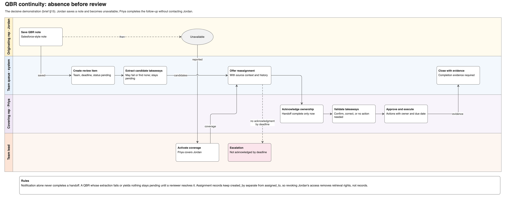
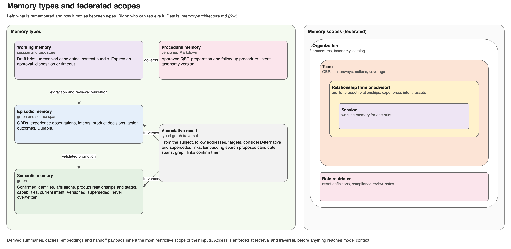
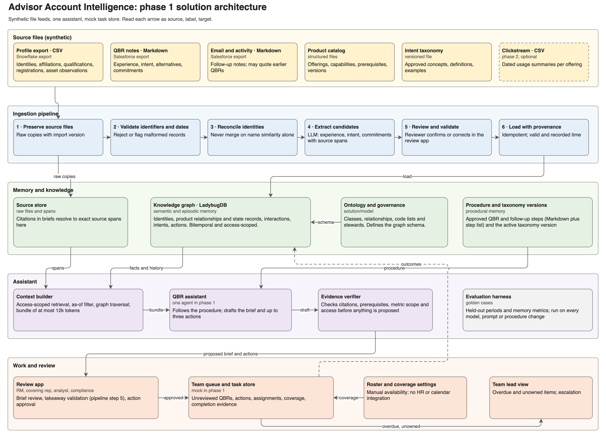

# Advisor Account Intelligence

A design for an evidence-grounded AI assistant that helps an investment platform's relationship teams prepare QBRs with advisors and advisory firms, and makes sure what was learned in a QBR is acted on, even when the rep who heard it is unavailable or leaves. All advisor, firm, product and asset data is synthetic; Platform A, Platform B and their offerings are fictional.

**Status (2026-10-19):** business requirements, solution design, memory architecture and a first conceptual model (draft v0.1) are drafted. A first runnable demo, with no LLM, plays the decisive scenario end to end over a LadybugDB graph and a mock task store, and 20 golden cases pass. Claude (`claude-opus-5-5`) extracts candidate takeaways from the QBR notes with structured outputs and writes a cited brief that a verifier checks before anyone sees it. On the synthetic notes it copied every span verbatim, recovered all hand-labelled takeaways and ignored an injected instruction; these are single runs, not accuracy rates. See [`solution/DEMO.md`](solution/DEMO.md) and the [sample brief](solution/samples/brief-FIRM-001-2026-03-20.md).

## The problem and the product

A rep captures a few QBR paragraphs in Salesforce, then goes on leave or leaves the firm. The investor experience the advisor described, the alternative product they are weighing and the specialist session that was promised all disappear into the note. When follow-up does happen, it can promote a product the advisor already rejected, add AUM to AUA, or treat a passed exam as a current registration.

The product responds in two parts:

| Part | What it does | Questions |
|---|---|---|
| Team-owned follow-up queue | Every saved QBR has a responsible team, a review deadline and a status, even when extraction fails. Approved actions have an owner, a covering rep and an escalation route. A handoff is complete only when acknowledged; an action closes only with evidence | CQ6 |
| Evidence-backed QBR brief | Products in use or under consideration, advisor-reported investor experience, alternatives, current intent and blockers, comparable asset observations, and up to three proposed actions, each cited to source and approved by a manager | CQ1–CQ5 |

The decisive demonstration removes the originating rep immediately after the note is saved. A covering rep must discover, validate, own and complete its takeaways from preserved evidence, without contacting the author.



## Competency questions

| ID | Question |
|---|---|
| CQ1 | Who is this advisor, which firms and platforms are they associated with, and which products do they use or consider? |
| CQ2 | What professional, platform and product milestones have changed since the last review? |
| CQ3 | What AUM/AUA information is available at firm, platform or product level, and which observations can be compared? |
| CQ4 | What investor/advisor experience is reported for each product, what alternatives are being considered, and what is the current intent? |
| CQ5 | Which product-related action should the relationship manager consider next, why, and what must be confirmed first? |
| CQ6 | Which QBRs still need review, which takeaways remain open, and who will follow through if the original rep is unavailable? |

## Memory at the core

The design treats memory correctness, meaning provenance, time and scope, as more important than memory volume:

- **Typed memory.** Semantic (confirmed identities, product relationships, capabilities), episodic (QBRs, experience, intent, outcomes), procedural (approved procedure and taxonomy versions) and working memory (draft brief, candidates). Associative recall is typed graph traversal.
- **Two kinds of time.** Every fact has a valid time and a recorded time, so a brief can be produced as of any past date without facts learned later.
- **Narrow supersession.** A new statement replaces only the memory with the same subject and product target; pausing one product evaluation leaves every other product relationship untouched.
- **Authority by field.** Registry evidence, catalogs, CRM records and conversations each own different fields. A conflicting statement raises a discrepancy instead of overwriting.
- **Federated scopes.** Organization, team, relationship, role and session scopes, enforced at retrieval, before anything reaches model context.
- **Evidence contracts.** Handoffs between agents, and between people, carry evidence references, verification state, scope and acknowledged ownership.



## Phase 1 architecture

Synthetic file feeds stand in for Snowflake and Salesforce exports. Ingestion preserves sources, reconciles identities and extracts candidate takeaways for review. A LadybugDB graph holds the connected working view, one assistant follows a versioned procedure, and a mock task store holds the team queue.



## Repository layout

| Path | Contents |
|---|---|
| [`business/advisor-account-intelligence-product.md`](business/advisor-account-intelligence-product.md) | Product brief v0.6: problem statements, competency questions, workflows, the synthetic scenario, product state rules, requirements, ROI method, golden test cases, ownership and rollout |
| [`solution/solution-design.md`](solution/solution-design.md) | Technology choices, knowledge model summary, product state machine, procedure, data feeds, taxonomy implementation, technical tests, serving and capacity |
| [`solution/memory-architecture.md`](solution/memory-architecture.md) | Memory types, scopes, temporal model, supersession, write path, multi-agent handoffs, context assembly, decay and memory evaluation |
| [`solution/model/`](solution/model/README.md) | The conceptual model, draft v0.1: Draw.io diagram (overview and four detail pages) with PNG renderings, OWL Turtle, stewardship and status per term, and a README with query approaches, decisions and checks |
| `solution/diagrams/` | Architecture and design diagrams (Draw.io sources and PNGs): solution architecture, product state transitions, QBR continuity workflow, memory types and scopes, write path, context assembly, agent handoff contract |
| [`solution/DEMO.md`](solution/DEMO.md) | The phase 1 demo: what each step shows, how it is built, which golden cases pass, and what it taught the model |
| `solution/aai/`, `solution/data/`, `solution/tests/` | Demo code (ingestion, memory promotion, task store, queries, narrated scenario), synthetic fixtures and golden tests |
| `solution/tools/` | Generators for the model and diagrams, the renderer and the structural model check |
| [`AGENTS.md`](AGENTS.md) | Modelling and Draw.io conventions for AI agents working in this repository |

## Where to start reviewing

1. The [product brief](business/advisor-account-intelligence-product.md), sections 4–9, for the problem, scope, scenario and requirements.
2. [`solution/memory-architecture.md`](solution/memory-architecture.md), for how the system remembers and forgets.
3. [`solution/model/README.md`](solution/model/README.md), which shows each model page as an image and maps every competency question to a query path. The editable source is `solution/model/aai-model.drawio` (diagrams.net).
4. Brief section 13, the golden test cases, and [`solution/DEMO.md`](solution/DEMO.md) for the ones the demo already passes. Run the demo to see the scenario play out.

## Running the demo

```bash
python3 -m venv .venv && .venv/bin/pip install -r solution/requirements.txt
cd solution
../.venv/bin/python -m aai.demo      # narrated scenario
../.venv/bin/python -m pytest -q     # golden cases
```

## Working with the model and diagrams

From the project root:

```bash
.venv/bin/python solution/tools/build_model.py        # Draw.io model and Turtle from model_spec.py
.venv/bin/python solution/tools/check_model.py        # diagram/Turtle structural checks
.venv/bin/python solution/tools/build_diagrams.py     # architecture and design diagrams
.venv/bin/python solution/tools/render.py --model     # model PNGs
.venv/bin/python solution/tools/render.py solution-design memory-architecture
```

`solution/tools/model_spec.py` is the single source for the model's concepts, relationships, pages, questions and synthetic examples. The generators overwrite manual edits; once a Draw.io file is edited by hand, it becomes the source. Rendering uses headless Google Chrome and fetches the diagrams.net viewer script from the network.

## Delivery plan

| Phase | Delivery |
|---|---|
| 1 | Grounded QBR brief, team follow-up queue with coverage, and basic temporal memory over two review cycles |
| 2 | Temporal memory at scale; optional clickstream usage summaries |
| 3 | Governed specialist agents with distinct permissions, compared against one assistant |
| 4 | Memory lifecycle: consolidation and decay without losing rejection reasons or required history |
| 5 | Reliable service at team scale: latency, concurrency and cost per accepted brief |

## Licence

Copyright 2026 Radu Marian. Licensed under the [Apache License 2.0](LICENSE).

## Limits

The problem statements, targets and ROI figures are hypotheses to validate with a platform relationship team; none is a measured result. The domain distinctions (Series exams, IAPD, Form ADV regulatory AUM, AUM versus AUA) were checked against FINRA, SEC, Investor.gov and issuer sources on 2026-10-19; registration and qualification rules still need jurisdiction-specific review, and nothing here decides authorization to practice or investment suitability. The model is a draft: every term is `proposed`, the Turtle parses with rdflib and matches the diagram but has not been run through a reasoner, and the Draw.io file has been checked in the diagrams.net viewer, not opened in the desktop app. The overview page is dense, and two detail pages have minor label crowding noted in the model README.
