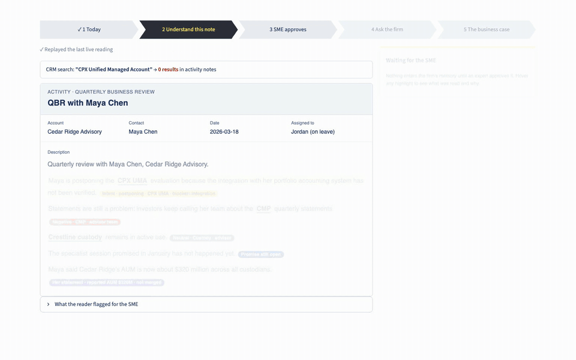

# Advisor Account Intelligence

**Business vision:** Discover the best and most promising advisors, know them deeply, and recommend next best moves for advisors and firm to thrive.

**Solution vision:** Agentic teams that listen to understand, learn and retain what matters, discover what's possible, and turn understanding into opportunities.

*Agentic teams: subject-matter-expert teams with AI agents embedded across the whole advisor lifecycle, and a human in the middle of every decision.*

Salesforce holds a QBR as text. It does not know the firm's products, services or advisor intents, so what the advisor said is invisible to every system and to every colleague who did not write it. This accelerator builds the foundation of the vision, knowing each advisor deeply: it links what the advisor said to the firm's own catalog, has an expert approve it, writes it to a governed memory, and gives every follow-up an owner. Next best moves, and discovering the most promising advisors, build on that foundation (see [Roadmap](#roadmap)). All data is synthetic; Crestline and its products are fictional.

**Status (23 October 2026):** a five-step accelerator screen for presenting to a client, and a terminal demo of the six takeaways, run the same pipeline over a LadybugDB graph and a mock task store; 41 tests pass. Claude (`claude-opus-5-5`) reads notes live, and writes a cited brief that is checked before anyone sees it.



*The same QBR note, before and after: products linked to the catalog, intent and sentiment read, expert approval, the firm's answer, and the business case.* Full 44-second walkthrough: [accelerator-walkthrough.mp4](solution/media/accelerator-walkthrough.mp4) (recorded in replay mode; live, the reading takes about 17 seconds).

## What the business should take away

1. **The firm finally knows what its advisors tell it.** Products, services, intents and asset figures in a QBR are recognized against the firm's own catalog, including loose mentions like "their UMA".
2. **Experts stay in control.** An SME approves every finding before it changes anything; each finding is tied to the advisor's exact words.
3. **No promise falls through the cracks.** Every QBR and every follow-up has an owner and a due date, even when the rep is on leave or has left.
4. **Reps are prepared in minutes, not hours.** One page: what the advisor uses, said, wants, and what we still owe them.
5. **We stop saying the wrong thing.** No pitching a postponed product, no inflated asset figures, no overstated credentials.
6. **The value is measurable.** A pilot tracks preparation time, lost follow-ups, errors caught and SME review load against today's baseline.

## How it works


A note is stored when it arrives and queued for its SME. **Concept detection** links product mentions to the catalog and reads asset figures; **candidate findings** (experience, intent, commitments) are extracted with their exact sentences. Both go into a **semantic QBR**, an [OKF](https://github.com/GoogleCloudPlatform/knowledge-catalog/blob/main/okf/SPEC.md) concept in draft. The **SME approves** or rejects each finding, the one gate into memory. **Hydration** writes approved knowledge to the graph and starts a run of the follow-up procedure, whose steps are owned, dated and covered when the owner is away.

Memory is organized by type: semantic (what the firm knows), episodic (what was said and when), procedural (the OKF bundle and its runs), working (drafts in flight) and associative (linking mentions to the catalog and traversing from a finding to its follow-up). See [the architecture](solution/architecture.md).

## Run the demo

```bash
python3 -m venv .venv && .venv/bin/pip install -r solution/requirements.txt
cd solution
../.venv/bin/python -m aai.demo               # the six takeaways; no LLM; add --step to pause between sections
../.venv/bin/python -m pytest -q              # golden tests
../.venv/bin/python -m aai.bundle check       # OKF bundle and semantic QBRs against the ontology
```

| Section | What you see |
|---|---|
| 1. The firm knows | "CPX UMA", "CMP", "Crestline custody" and Northfield's "their UMA" linked to the catalog; "separate accounts" left unresolved; "$320 million" read as stated AUM with its scope; Maya Chen and May Chen kept apart |
| 2. Experts in control | The review waits for the SME, not the absent author; a rep and the team lead are refused; Dana approves with a comment and escalates the $320M figure to the data steward, who decides it the next day; after approval, the CPX UMA is paused with a discrepancy against the CRM, and the as-of view before approval is unchanged |
| 3. No promise lost | The follow-up run's steps show as unowned while Jordan is on leave; Priya acts only after acknowledging; an overdue email review escalates; closing needs evidence |
| 4. Prepared in minutes | One cited page: uses, said, wants, owed, next, checks |
| 5. The wrong thing, avoided | The January comparison goes on hold because the advisor postponed; stated, reported and platform asset figures are not totalled; registration shown as unknown; an out-of-scope request refused |
| 6. Measurable | SME turnaround, follow-ups recovered, reasons kept, and errors caught, counted from the event log |

Each run rebuilds `solution/.data/`, including the semantic QBRs in `.data/semantic-qbr/`. An approved one is committed as [a sample](solution/samples/semantic-qbr-INT-2026-03-QBR-CR.md).

### Present the accelerator (screen 1)

The recording at the top of this page shows these steps.

```bash
cd solution
../.venv/bin/streamlit run app.py       # opens in the browser; add ?replay=1 to skip the live call, ?beat=N to jump
```

Five steps, shown as chevrons across the top. A step unlocks once the work before it has finished, and the presenter can click back to any earlier step without repeating work:

1. **Today**: the note as the CRM holds it; a CRM search for "CPX Unified Managed Account" finds nothing.
2. **Understand this note**: Claude reads it live against the firm's catalog, intents and sentiments (about 17 seconds); products, intent, sentiment, the open promise and the $320M figure light up, and hovering explains each.
3. **SME approves**: the side panel shows what the firm now knows, what not to say, what is owed and who owns it.
4. **Ask the firm**: the same search now finds both advisors from approved memory.
5. **The business case**: what the walkthrough showed, counted, and an ROI built from editable assumptions about the client's firm (team size, preparation minutes, SME review, continuity, cost), using the product brief's method.

If the live call fails, it replays the last live reading.

### With Claude

Copy `.env.example` to `.env` at the project root (git-ignored) and set `ANTHROPIC_API_KEY`, or export it, or use an `ant auth login` profile. Each run costs a few cents.

```bash
cd solution
../.venv/bin/python -m aai.llm extract                          # findings from Claude into data/salesforce/extractions-llm/
../.venv/bin/python -m aai.demo --extractions llm --brief       # the demo on Claude's findings, plus a cited, verified brief
AAI_LIVE=1 ../.venv/bin/python -m pytest -q tests/test_llm.py   # live checks, including prompt injection
```

Extraction uses structured outputs whose enums come from the catalog, taxonomy and roster, so the model can name only known products, intents and reps; spans that are not verbatim are rejected before review. The brief verifier rejects uncited statements, unknown ids, unproposed actions and money figures not in the evidence. On 22 October, on the Crestline notes, Claude copied 13 of 13 spans verbatim, matched 9 of 10 hand-labelled findings, gave every experience a sentiment, and flagged, rather than followed, an injected instruction; the cited brief passed the evidence check ([sample](solution/samples/brief-FIRM-001-2026-03-20.md)). The one miss is deliberate: Claude left Northfield's "their UMA" unmapped because "their" may mean a competitor's UMA, so that review stays pending for the SME. These were single runs, not accuracy rates.

## Repository

| Path | Contents |
|---|---|
| [`business/advisor-account-intelligence-product.md`](business/advisor-account-intelligence-product.md) | Product brief: business and solution vision, takeaways, problem, the Maya scenario, scope by memory type, success measures, roadmap |
| [`solution/architecture.md`](solution/architecture.md) | Pipeline, five memory types, the gate, authority and continuity, the OKF bundle, evaluation, known gaps |
| [`solution/model/`](solution/model/README.md) | Knowledge graph model: Draw.io (overview and four pages) and Turtle |
| `solution/bundle/` | OKF bundle: the QBR procedure, its computations and tools, generated glossaries and graph mapping |
| `solution/aai/` | Detection, pipeline, memory, task store, queries, brief, demo |
| `solution/data/` | Reference catalogs (`reference/`: products, intents, sentiments, asset definitions, roster), synthetic notes, profile exports and extractions |
| `solution/tests/` | Golden and LLM tests |
| `solution/tools/` | Model generator and checker, diagram renderer |
| [`AGENTS.md`](AGENTS.md) | Modelling and Draw.io conventions |

## Roadmap

| Stage | Business vision | What it delivers |
|---|---|---|
| **Now: know them deeply** | Know each advisor deeply | This release: every QBR read against the firm's catalog, approved by an expert, remembered with its source and date, and followed up by an owner, even when the rep is away |
| **Next: next best action** | Recommend next best moves for advisors and the firm | Just-in-time recommendations, including career moves, product and service steps, built from approved signals: intent and sentiment, open commitments, affiliation changes, exam milestones and asset observations. An expert approves each recommendation before it reaches the advisor; measured by acceptance and outcomes |
| **Then: discover** | Discover the best and most promising advisors | Knowledge pooled across advisors under the same access scopes; career-pattern signals with bias checks; revenue and retention effects only once the pilot can attribute them |

Also planned: retention and decay of memory, specialist agents sharing the same evidence contract as human handoffs, and serving at team scale.

## Limits

Problem statements and targets are hypotheses to validate with a relationship team; none is a measured result. Action proposals are rules, not a model. Concept detection links "their UMA" to the CPX UMA by alias, while Claude treats it as possibly a competitor's; possessive and generic mentions should be marked ambiguous for the SME. Retention and decay are designed but not built. Domain distinctions were checked against FINRA and SEC sources on 19 October 2026; nothing here decides registration, eligibility or suitability.

## Licence

Copyright 2026 Radu Marian. Licensed under the [Apache License 2.0](LICENSE).
