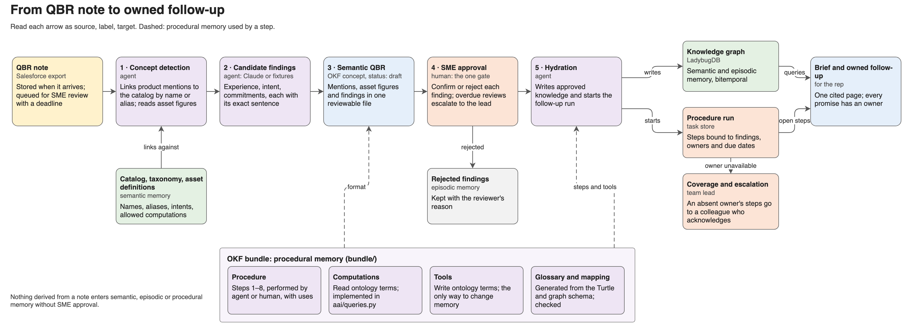
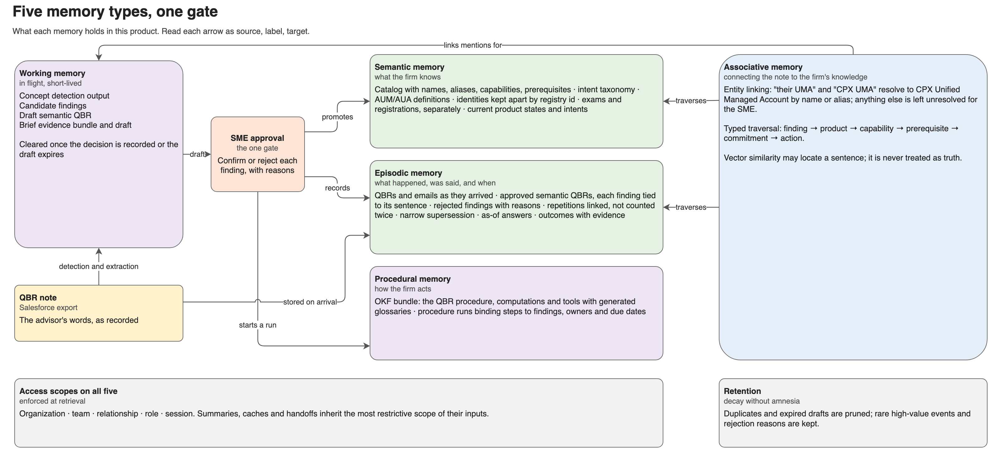

# Advisor Account Intelligence: architecture

Version 0.3 · 22 October 2026 · Companion to [the product brief](../business/advisor-account-intelligence-product.md)

The product turns each QBR note into knowledge the firm can act on. This document describes how: the pipeline, the five memory types it reads and writes, the one gate between them, and the OKF bundle that holds the procedure. Code paths are under `solution/`.

## 1. Pipeline



| Step | Performed by | Code | Output |
|---|---|---|---|
| Note arrives | system | `aai/ingest.py` | The note is stored with its import version; a review item gets an owner (the team's SME) and a deadline, whether or not anything is extracted |
| 1 · Concept detection | agent | `aai/detect.py` | Product mentions linked to the catalog by name or alias, longest phrase first, whole words only; product words with no link marked unresolved; asset figures read with their metric and scope |
| 2 · Candidate findings | agent | `aai/llm.py` or fixtures | Experience (with sentiment), intent and commitments, each with a span copied verbatim from the note. A span that is not verbatim is rejected before review; a quoted repetition is linked to its original |
| 3 · Semantic QBR | agent | `aai/pipeline.py#draft` | One OKF concept (`status: draft`) with mentions, asset figures and findings, each tied to its sentence, and the ontology terms its findings would write |
| 4 · SME approval | human | `aai/pipeline.py#approve` | Each finding confirmed, rejected with a reason, or escalated with a comment to a named expert; any decision may carry a comment. Approved findings go ahead; the file is `partially verified` until escalated findings are decided, then `verified` |
| 5 · Hydration | agent | `aai/pipeline.py#hydrate` | Approved findings in the graph; the semantic QBR and its mentions as nodes; a procedure run with proposed actions owned by the relationship owner |
| 6–8 · Follow-up | agent, then human | `aai/queries.py#propose_actions`, `aai/tasks.py` | Up to three actions grounded in approved findings; approved, dismissed with a reason, or completed with evidence |

Source text is data: instructions inside a note are flagged for the reviewer and never followed (`data/adversarial/`, `tests/test_llm.py`).

## 2. Five memory types



| Memory | Holds | Store | Written by | Lifetime |
|---|---|---|---|---|
| Semantic: what the firm knows | Product catalog (names, aliases, capabilities, prerequisites), intent catalog, sentiment catalog, AUM/AUA definitions and allowed computations, identities, exams and registrations kept apart, current product states and intents | `data/reference/`, graph | Authoritative feeds; promotion of approved findings | Durable; superseded, never overwritten |
| Episodic: what happened, was said, and when | Notes and emails as they arrived, approved semantic QBRs, findings tied to their sentence, rejected findings with reasons, repetitions, outcomes with evidence | Graph plus source files, task store, `.data/semantic-qbr/` | Ingestion (notes) and the gate (findings) | Durable |
| Procedural: how the firm acts | The OKF bundle; procedure runs binding steps to findings, owners and due dates | `bundle/`, task store, graph | Authored and versioned; runs started by hydration | Durable; versioned |
| Working: in flight | Detection output, candidate findings, the draft semantic QBR, the brief's evidence bundle and draft | Task store, `.data/` | Agents | Until the decision is recorded or the draft expires |
| Associative: connecting the note to the firm's knowledge | Entity links from mentions to offerings; typed traversal from a finding to product, capability, prerequisite, commitment and action | Derived over semantic and episodic memory | Detection and hydration | Computed per query |

**One gate.** Nothing derived from a note moves from working memory into semantic, episodic or procedural memory without SME approval. The note itself is stored on arrival, so a QBR nobody has reviewed stays visible.

**Access scopes apply to all five.** Organization, team, relationship, role and session scopes are enforced at retrieval (`aai/queries.py#_check`), before anything reaches model context. Summaries and handoffs inherit the most restrictive scope of their inputs.

**Retention.** Duplicates and expired drafts are pruned; rare high-value events and rejection reasons are kept. Pruning is evaluated against an unpruned baseline before it is switched on. Not yet built.

## 3. Time and supersession

Every fact carries a valid time (when it was true) and a recorded time (when the firm learned it, which for a finding is the approval date). An as-of answer for date D returns facts valid at D and recorded by D, so a brief prepared on 19 March cannot use what the SME approved on 20 March.

| Rule | Example in the demo |
|---|---|
| A later statement supersedes only the same subject and product | March "postponing CPX UMA" supersedes January "exploring"; custody and Model Portfolios are untouched |
| Repetition is not confirmation | The February email quotes January; it is linked with `quotes`, not counted |
| Sources do not overwrite each other | The CRM's "pilot ready" and the approved "paused" both stay; a Discrepancy links them |
| Testimony stays testimony | The advisor's "$320 million AUM" is stored as her statement, never merged with the firm-reported $300M or the platform's $180M AUA |
| History is kept | Superseded intents, dismissed actions and rejected findings remain queryable with reasons |

The reference catalogs are in `data/reference/`: `catalog.yaml` (products), `intents.yaml` (each intent's definition, examples and the product state it may propose), `sentiments.yaml` (each sentiment's definition and the follow-up it triggers) and `asset_definitions.yaml`. Intent concepts and sentiments are nodes in the graph, so findings link to them.

Product state changes follow the rules in the product brief: a conversation can propose evaluating, paused or rejected, never using, expanding or discontinued, which need operational records.

## 4. Authority and continuity

| Work | Who may act | When they cannot |
|---|---|---|
| Approve findings | The team's SME; another SME holding an acknowledged assignment | The team lead may record "no action needed" with a reason or reassign, but cannot confirm findings |
| Decide an escalated finding | Only the named expert (another SME, such as the data steward or a product specialist), within the review days | Overdue escalations go to the team lead; the finding stays out of memory until decided |
| Approve, dismiss or complete an action | Its owner (the relationship owner) if available; a rep holding an acknowledged assignment; the team lead | A notification alone grants nothing |
| Activate coverage | The team lead | |

Overdue reviews and unacknowledged offers escalate to the team lead. Retrying an offer or acknowledgment adds nothing. An action closes only with completion evidence, which is written to the graph. When a newly approved intent postpones or rejects a product, open actions that would pitch it go on hold with the reason (`aai/pipeline.py#hold_stale_actions`).

## 5. OKF bundle

The procedure, its computations and its tools are an [Open Knowledge Format v0.2](https://github.com/GoogleCloudPlatform/knowledge-catalog/blob/main/okf/SPEC.md) bundle in `bundle/`, with the Ontology Grounding extension borrowed from the cross-border private equity project:

- `index.md` declares the ontology: prefix `aai`, `model/aai-model.ttl`.
- Computations declare the terms they `reads`; tools the terms they `writes`; everything declares what it `supports`. Each names the code that implements it (`implemented_by`).
- The procedure's `steps` say who performs each step (`agent` or `human`, with a role) and which computations and tools it `uses`.
- Each computation and tool carries a `# Glossary` generated from the Turtle and from `references/mappings/graph.yaml`, which is itself generated from the graph schema in `aai/graph.py`.
- Concepts an agent writes are `status: draft`; only a person sets `verified`.

New here: the semantic QBR is itself an OKF concept, checked by the same rules.

```bash
cd solution
../.venv/bin/python -m aai.bundle check                        # terms exist, paths and code resolve, glossaries current
../.venv/bin/python -m aai.bundle glossary                     # regenerate glossaries after an ontology change
../.venv/bin/python -m aai.bundle mapping                      # regenerate the graph mapping after a schema change
../.venv/bin/python -m aai.bundle affected aai:ProductMention  # what a term change touches
```

## 6. Knowledge model

The structural model is in [model/](model/README.md): a Draw.io file with an overview and four detail pages, and its OWL counterpart `aai-model.ttl`, which also holds steward and status per term. Conventions are in [AGENTS.md](../AGENTS.md). Version 0.2 added Semantic QBR, Product Mention, Procedure and Procedure Run, and `alias` on offerings and platforms. Version 0.3 adds the Sentiment code list, linked from Experience Observation by `hasSentiment`.

## 7. The brief

The evidence bundle is assembled from scoped, as-of queries; every item has an id (`aai/brief.py#bundle`). Without a model, `one_page` prints what the advisor uses, said, wants, and what the team still owes, each line cited. With `--brief`, Claude writes cited statements under structured output, and `verify` rejects uncited statements, unknown ids, actions that were not proposed, and money figures absent from the bundle before anyone sees the draft.

## 8. Evaluation

`tests/test_golden.py` covers the six takeaways: catalog linking of specific and loose mentions, asset reading, identity separation, nothing in memory before approval, SME-only approval, rejection reasons kept, as-of answers, narrow supersession, discrepancies, hydration into a run, unowned-but-visible work, acknowledgment before action, escalation, evidence on completion, pitches held back, stated AUM kept apart, registration gaps, unknown capabilities, access scope, and bundle consistency. `tests/test_llm.py` checks the brief verifier offline and, with `AAI_LIVE=1`, extraction and prompt injection against Claude.

Memory metrics for the pilot: required-evidence recall, as-of correctness, supersession precision, attribution accuracy, leakage (target zero), handoff fidelity, SME review time, and decay safety once retention is built.

## 9. Technology and later work

LadybugDB holds the graph; SQLite stands in for the task system; CSV and Markdown stand in for Snowflake and Salesforce exports. Claude (`claude-opus-5-5`) is used through structured outputs with a cached system prompt. Later work, each kept only if measured to help: retention and decay; specialist agents sharing the same evidence contract as human handoffs; serving at team scale (latency, concurrency, cost per accepted brief).

## 10. Known gaps

- Concept detection links "their UMA" to the CPX UMA by alias. Claude, re-run on 22 October, left it unmapped because "their" may mean a competitor's UMA. Possessive and generic mentions should be linked as ambiguous and confirmed by the SME, not resolved silently.
- Product-word detection is a fixed list in the catalog; unusual phrasings stay unlinked rather than wrongly linked.
- Retention and decay are designed, not built. Taxonomy curation and clickstream are out of the first release.
