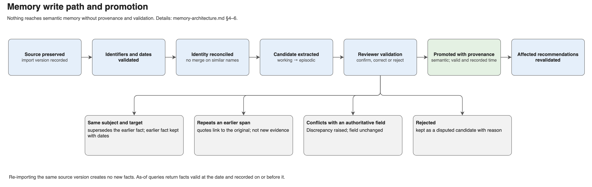
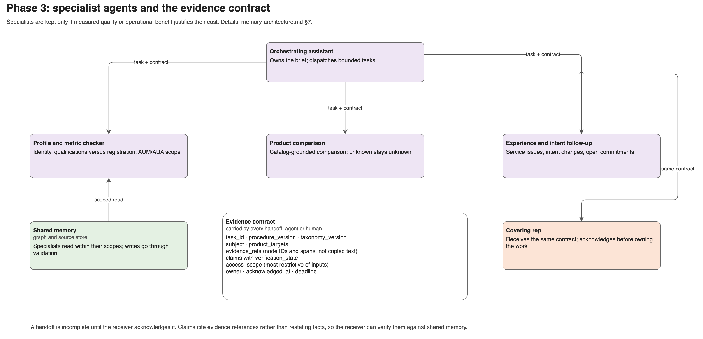
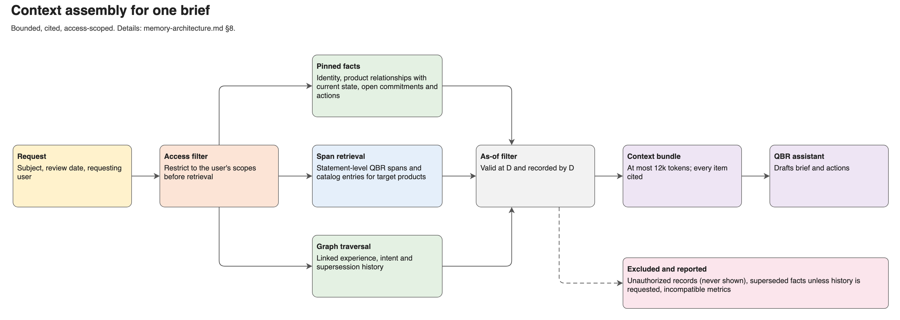

# Advisor Account Intelligence — Memory Architecture

Solution design · Version 0.1 · 19 October 2026 · Companion to [the product brief](../business/advisor-account-intelligence-product.md) and [solution design](solution-design.md)

## 1. Purpose

Define how the product remembers advisors, firms, products, conversations, and work so that answers stay correct over time, across people, and across agents. The design is domain-specific in its fixtures but domain-agnostic in its mechanics: memory types, provenance, supersession, scoped access, decay, and handoff contracts are intended to be reusable in other relationship-intelligence systems.

Design principles:

1. **Provenance before recall.** Every remembered fact carries its source, speaker, scope, and dates; a fact without provenance is not eligible for a brief.
2. **Authority by field.** Memory records what each source says; it does not let a later or louder source silently overwrite a field owned by another source.
3. **Time is two-dimensional.** Store when a fact was true (effective time) separately from when the system learned it (recorded time).
4. **Supersede narrowly.** A new statement replaces only the memory with the same subject and target.
5. **Forget duplicates, not reasons.** Decay removes redundancy and stale working state, never rejection reasons, decision history, or source references required for audit.
6. **Enforce access at retrieval.** Unauthorized memory never enters model context; filtering generated output afterwards is insufficient.

## 2. Memory types


Source: [diagrams/memory-architecture.drawio](diagrams/memory-architecture.drawio). The concepts named here are defined in the [model](model/README.md).

| Memory type | Content in this product | Store | Write path | Lifetime |
|---|---|---|---|---|
| Semantic | Confirmed identities, affiliations, qualifications, registrations, versioned product capabilities, current product relationships and intents | Graph (LadybugDB) | Validated promotion from episodic evidence or authoritative feeds | Durable; versioned, superseded rather than deleted |
| Episodic | QBR interactions, experience observations, stated intents, product decisions, affiliation changes, action outcomes | Graph nodes plus preserved source files and spans | Extraction → candidate → reviewer validation | Durable; duplicates consolidated in phase 4 |
| Procedural | Approved QBR-preparation and follow-up procedures, taxonomy versions | Versioned Markdown plus structured step list | Manual authoring and approval | Durable; versioned |
| Working | Draft brief, unresolved candidates, current task state, retrieved context bundle | Session/task store | Agent runtime | Expires on approval, disposition, or timeout; promoted only through validation |
| Associative (access pattern) | Paths linking advisor → firm → product relationship → experience → intent → action | Graph traversal over semantic and episodic memory | Derived; not stored separately | Computed per query |

Associative recall is implemented as typed graph traversal rather than embedding similarity alone: "what else do we know that matters for this intent" follows explicit relationships such as `addresses`, `targets`, `considers_alternative`, and `supersedes`. Embedding search is used to locate candidate source spans, then confirmed against graph links.

## 3. Memory scopes (federated memory)

| Scope | Contents | Shared with |
|---|---|---|
| Organization | Approved procedures, intent taxonomy, product catalog | All authorized roles |
| Team | QBR interactions, takeaways, actions, coverage records for assigned relationships | The accountable team, its lead, and designated covering reps |
| Relationship (firm/advisor) | Profile, product relationships, experience, intents, asset observations | Roles assigned to that relationship |
| Role-restricted | Asset definitions under data-steward control, compliance review notes | Named roles only |
| Session | Working memory for one brief or task | The executing agent and its approving user |

A platform reference in an advisor's profile does not grant access to that provider's private data. Derived summaries, caches, embeddings, and handoff payloads inherit the most restrictive scope of their inputs. Revoking a user's access removes retrieval rights, not records.

## 4. Temporal model

Each fact carries:

- `valid_from` / `valid_to` — effective time of the fact in the world
- `recorded_at` / `retracted_at` — when the system learned or withdrew it
- `source_id`, `source_span`, `import_version` — provenance
- `verification_state` — candidate, validated, disputed, superseded

An as-of query for date D returns facts valid at D **and** recorded on or before D. This prevents a brief prepared for January from using what was learned in March (FR5).

## 5. Supersession rules

| Rule | Example |
|---|---|
| Same subject, same target, later statement supersedes | March "postponing Service B" supersedes January "considering Service B" |
| Different target is independent | Pausing Service B leaves Custody Service A and Service A intents unchanged |
| Repetition is not confirmation | A forwarded email quoting the January QBR links to the original span; it does not create an independent observation |
| Testimony does not overwrite authoritative fields | An advisor statement contradicting registry or CRM data raises a discrepancy instead of replacing the field |
| History is retained | Superseded facts remain queryable with their reasons and dates |

## 6. Write path and promotion



```
source file preserved → identifiers/dates validated → identity reconciled
  → candidate extraction (episodic, working) → reviewer validation
  → promotion to semantic memory with provenance → affected recommendations revalidated
```

A material change to evidence behind a pending recommendation reopens that recommendation for validation (FR8). Promotion is idempotent: re-importing the same source version does not create new facts (FR7).

## 7. Multi-agent memory communication

Phase 1 uses one assistant. Phase 3 introduces bounded specialists — profile/metric checker, product comparison, experience/intent follow-up — kept only if measured quality or operational benefit justifies their cost.



Agents share memory through an **evidence contract**, not free-text messages:

| Field | Purpose |
|---|---|
| `task_id`, `procedure_version`, `taxonomy_version` | Reproducibility |
| `subject` (advisor/firm), `product_targets` | Scope of the handoff |
| `evidence_refs` | Node IDs and source spans, not copied text |
| `claims` with `verification_state` | What the sender asserts and how sure it is |
| `access_scope` | Most restrictive scope of included evidence |
| `owner`, `acknowledged_at`, `deadline` | Accountability; a handoff is incomplete until acknowledged |

The same contract governs human handoffs: a covering rep receives the same evidence references and history as an agent would.

## 8. Context assembly



For each brief, the context builder assembles a bounded bundle (initial envelope: up to 12,000 input tokens):

1. Pinned: subject identity, product relationships with current state, open commitments and actions.
2. Retrieved: QBR source spans chunked at statement level with speaker and date; catalog capability entries for target products and alternatives.
3. Traversed: linked experience, intent, and supersession history for each target product.
4. Excluded and reported: incompatible metrics, unauthorized records, superseded facts unless history is requested.

Chunking follows source structure (QBR paragraph → statement span) rather than fixed token windows, so citations point to the exact statement.

## 9. Retention and decay (phase 4)

| Memory | Policy |
|---|---|
| Duplicate experience reports | Consolidate into one observation with multiple supporting sources |
| Stale intent | Mark stale after a configurable period without reconfirmation; do not delete |
| Rejection and decision reasons | Never decayed |
| Working memory | Expire after approval, disposition, or timeout |
| Raw source files | Retained per approved retention policy (open decision) |

Evaluate pruning against an unpruned baseline: storage and context savings must not reduce required-evidence retrieval or lose rare high-value events.

## 10. Memory evaluation

| Metric | Measures |
|---|---|
| Required-evidence recall | Did the brief retrieve every fact the golden case requires? |
| As-of correctness | Did historical answers exclude later-recorded facts? |
| Supersession precision | Did updates change only the intended subject/target? |
| Attribution accuracy | Speaker, affected party, and product target correct |
| Leakage rate | Unauthorized records in context or output (target: zero) |
| Decay safety | Savings achieved with no loss of required history |
| Handoff fidelity | Receiver can act without contacting the sender |

Evaluations combine human-designed golden cases with agent-generated adversarial variants (paraphrased intents, near-duplicate names, conflicting sources), reviewed before inclusion.
