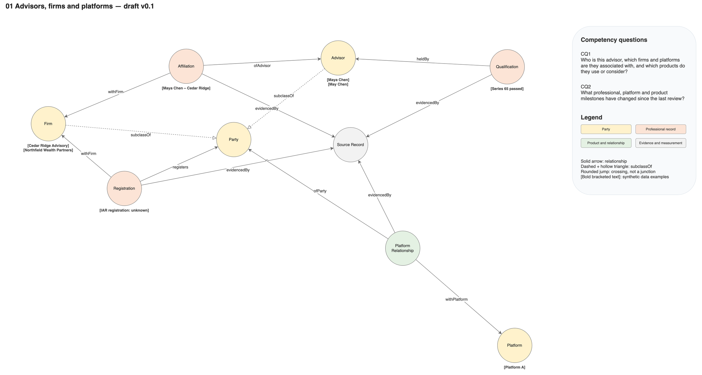
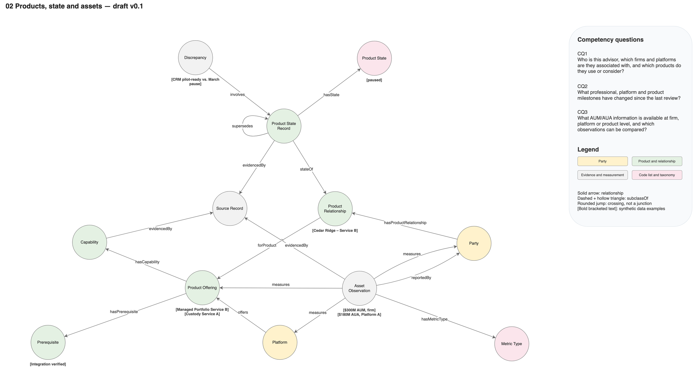
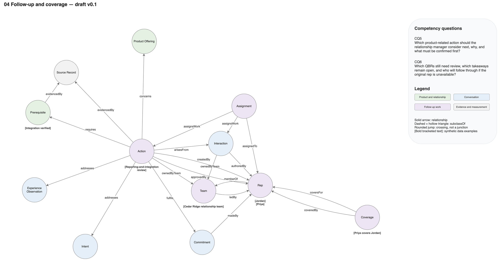

# Advisor Account Intelligence conceptual model — draft v0.1

Open `aai-model.drawio` in diagrams.net/draw.io. It contains an overview page and four editable detail pages with colored circular concepts and labeled, directed relationships. Dashed `subclassOf` arrows with a small hollow triangle denote proposed specializations and point to the superclass. Other arrows are candidate relationships, one name per connector. Modeling conventions are in [AGENTS.md](../../AGENTS.md).

The model formalizes the knowledge model in [solution-design.md](../solution-design.md) §2 and supports the memory design in [memory-architecture.md](../memory-architecture.md). Business context is in the [product brief](../../business/advisor-account-intelligence-product.md).

## Diagrams

PNG renderings of each page are in `diagrams/`. The Draw.io file is the source; regenerate the images after any diagram change with `.venv/bin/python solution/tools/render.py --model` from the project root.

### 00 Model overview

### 01 Advisors, firms and platforms

### 02 Products, state and assets

### 03 Interactions, experience and intent

### 04 Follow-up and coverage

## Purpose and scope

A first conceptual ontology for a platform's relationship-intelligence product: advisors, the firms they are affiliated with, the platforms and product offerings they use or consider, what they said in QBRs, and the team-owned work that follows. It describes structure and the evidence needed to answer the brief's competency questions. It is not a registration rules engine, a suitability model or a model of investor portfolios.

## Competency questions

| ID | Question | Page and proposed query approach |
|---|---|---|
| CQ1 | Who is this advisor, which firms and platforms are they associated with, and which products do they use or consider? | Pages 01–02: Advisor ← ofAdvisor ← Affiliation → withFirm → Firm, valid at the review date; Party → hasProductRelationship → Product Relationship → forProduct → Product Offering, with the latest confirmed Product State Record per relationship. Identity matches are never inferred from similar names |
| CQ2 | What professional, platform and product milestones have changed since the last review? | Pages 01–03: dated Affiliation, Qualification, Registration, Platform Relationship and Product State Record facts whose valid or recorded time falls between the two review dates; supersedes chains for state and intent |
| CQ3 | What AUM/AUA information is available at firm, platform or product level, and which observations can be compared? | Page 02: Asset Observation → measures → Party/Platform/Product Offering, grouped by hasMetricType and as-of date. Observations are comparable only with the same metric type, compatible scope and date; no totals across types or scopes |
| CQ4 | What investor/advisor experience is reported for each product, what alternatives are being considered, and what is the current intent? | Page 03: Interaction → records → Experience Observation → concerns → Product Offering, with reportedBy and affects; Interaction → expresses → Intent → targets / considersAlternative, latest in each supersedes chain. Spans that only quote earlier spans are not counted as new evidence |
| CQ5 | Which product-related action should the relationship manager consider next, why, and what must be confirmed first? | Pages 02 and 04: Action → addresses → Experience Observation/Intent, → concerns → Product Offering, → requires → Prerequisite → evidencedBy → Source Record (absent means unverified) |
| CQ6 | Which QBRs still need review, which takeaways remain open, and who will follow through if the original rep is unavailable? | Page 04: Interaction → ownedByTeam → Team with review status; Assignment → assignsWork → Action/Interaction → assignedTo → Rep, effective only when acknowledged; Coverage → coversFor / coveredBy → Rep; Team → ledBy → Rep for escalation |

## Modeling decisions proposed for review

- **Party.** Advisor and Firm are kinds of Party, so product relationships, interactions and asset observations can attach to either. Platform is kept separate: it is a provider with offerings, not a relationship the platform manages. Rep is internal and disjoint from Party.
- **Separate professional tracks.** Qualification and Registration are unrelated concepts with separate evidence. No relationship lets an exam result imply registration or eligibility.
- **Product state as dated records.** Product Relationship holds identity; each state change is a Product State Record with its own source, verification state and `supersedes` link. A Discrepancy links records that disagree, such as a CRM record and a confirmed QBR statement. The transition rules are in brief §8.
- **Platform relationship separate from product relationships.** Pausing one product relationship has no structural path to the platform relationship.
- **Assets at evidenced scope.** Asset Observation measures exactly what its source measures. There is no relationship that allocates a firm figure to an advisor or product.
- **Speaker and affected group.** Experience Observation has both `reportedBy` (who said it) and `affects` (whose experience it is), so advisor-reported investor frustration is not recorded as an investor statement.
- **Repetition is not confirmation.** Source Span `quotes` Source Span; the February email's quotation links to the January span.
- **Intent taxonomy as data.** Intent Concept and Taxonomy Version are SKOS concepts and schemes; the seven seed labels are individuals in the Turtle, not classes.
- **Authorship independent of assignment.** `createdBy` and `authoredBy` are separate from Assignment, so a rep can leave without orphaning work. Assignment and Coverage carry `acknowledgedAt`; notification alone does not set it.
- **Time as attributes.** `validFrom`, `validTo` and `recordedAt` are attributes in the Turtle, not concepts on the diagram, matching the bitemporal model in memory-architecture §4.

Open:

- Whether Commitment and Action should merge once a commitment is approved as an action, or stay linked by `fulfils` as now.
- Whether Discrepancy should also link registry facts (Registration, Affiliation), not only Product State Records.
- Whether Platform should become a kind of Party if platforms are ever the subject of interactions.

## Formal ontology

`aai-model.ttl` is the OWL 2 counterpart of the diagram: the same 33 classes, 47 relationships (as object properties) and 4 subclass links as `00 Model overview`, plus 29 data properties and four SKOS code lists (product state, metric type, affected group, seed intent taxonomy). `aai-governance.ttl` holds steward and lifecycle status for every term; all are `proposed`. The namespace `https://w3id.org/aai/ontology#` is a placeholder and is not registered.

Axioms beyond the diagram: Advisor is disjoint with Firm, Rep is disjoint with Party, and several relationships are functional (for example one product per product relationship, one product relationship per state record, one interaction per source span).

## How the files are produced

`solution/tools/model_spec.py` is the single source for concepts, relationships, pages, questions and examples. `solution/tools/build_model.py` generates the Draw.io file and both Turtle files from it. Layout uses a deterministic Fruchterman–Reingold force-directed pass (networkx `spring_layout`) for each page, with a seed search that scores crossings, connector clearance from circles and example notes, and label overlaps, followed by overlap relaxation. Parallel relationships between the same pair are curved on opposite sides; self-relationships loop on the freest side. Regenerating overwrites manual edits to the diagram; once the diagram is edited by hand, it becomes the source and the spec must be updated to match.

## Checks in v0.1

`solution/tools/check_model.py` passed:

- The XML parses; cell identifiers are unique per page.
- Every connector has one name and existing endpoints; subclassOf connectors are dashed with hollow triangles.
- Each page has a right-side panel with questions and legend; the overview has no examples; examples are bracketed.
- The overview equals the union of pages 01–04 (33 concepts, 70 connectors).
- The Turtle parses with rdflib. Its classes, object properties and subclass axioms equal the overview's.
- Every term has a definition and a steward.

All five pages were rendered with the diagrams.net viewer and inspected:

- **Pages 01 and 02** are clean.
- **Pages 03 and 04** are readable. On page 03 the `quotes` loop on Source Span sits near the `concerns` label. On page 04 two edges leaving Action pass through its example note, and several labels crowd near Rep.
- **The overview** is dense. Labels overlap near Party and Product Offering, and several connectors pass close to circles.

The file has not been opened in the Draw.io desktop app, so line jumps there are not visually verified. The Turtle has not been run through an OWL reasoner or profile checker.
