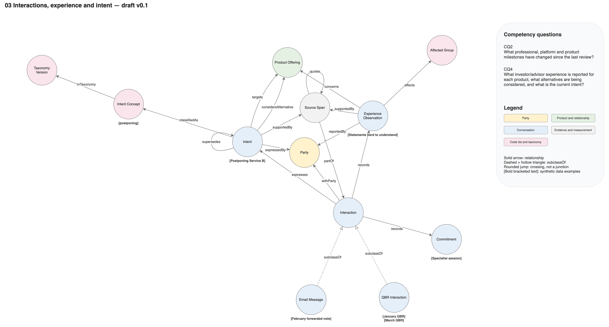

# Knowledge graph model, draft v0.3

`aai-model.drawio` holds an overview and four detail pages; `aai-model.ttl` is its OWL counterpart, with steward and status (all `proposed`) per term. Conventions are in [AGENTS.md](../../AGENTS.md); how the model is used is in [architecture.md](../architecture.md). Both files are generated from `solution/tools/model_spec.py`:

```bash
.venv/bin/python solution/tools/build_model.py   # Draw.io (force-directed layout, fixed seeds) and Turtle; takes about 3 minutes
.venv/bin/python solution/tools/check_model.py   # overview = union of pages; Turtle matches the diagram; every term defined and stewarded
.venv/bin/python solution/tools/render.py --model
```

After a model change, run `python -m aai.bundle glossary` and `check` from `solution/` so the OKF glossaries follow.

| Page | Shows | Answers |
|---|---|---|
| [00 Model overview](diagrams/00-model-overview.png) | Every concept and relationship once | CQ1–CQ6 |
| [01 Advisors, firms and platforms](diagrams/01-advisors-firms-and-platforms.png) | Identities, affiliations, exams and registrations kept apart | CQ1, CQ2 |
| [02 Products, state and assets](diagrams/02-products-state-and-assets.png) | Offerings, dated state records, discrepancies, assets at their scope | CQ1–CQ3 |
| [03 Interactions, experience and intent](diagrams/03-interactions-experience-and-intent.png) | Findings tied to spans and sentiment; semantic QBRs and product mentions | CQ2, CQ4 |
| [04 Follow-up and coverage](diagrams/04-follow-up-and-coverage.png) | Actions, procedure runs, ownership and coverage | CQ5, CQ6 |



**v0.2 adds** Semantic QBR (`interprets` an Interaction, `contains` Product Mentions, `approvedBy` a Rep), Product Mention (`foundIn` a Source Span, `refersTo` a Product Offering), Procedure and Procedure Run (`follows`, `startedBy`; Action `partOfRun`), Asset Observation `supportedBy` Source Span, and the attributes `alias`, `approvalStatus`, `phrase`, `linkMethod` and `procedureVersion`. The governance Turtle was folded into `aai-model.ttl`. **v0.3 adds** the Sentiment code list (negative, positive, mixed, neutral, not recorded) and Experience Observation `hasSentiment` Sentiment, with the attribute `followUp`, and `reviewComment` on findings so SME and expert comments stay in memory.

**Open:** whether Platform becomes a kind of Party (a platform reports AUA, but `reportedBy` ranges over Party); whether Commitment and Action merge; whether Discrepancy should also link registry facts; and which store is authoritative for Assignment and Coverage (the task store, today).

**Checked:** `check_model.py` passes, and every page was rendered and inspected. Page 03 is crowded around Source Span (the `quotes` loop crosses its label), page 04 has crowded labels near Rep and Team, and the overview is dense. The file has not been opened in the Draw.io desktop app, and the Turtle has not been run through a reasoner.
