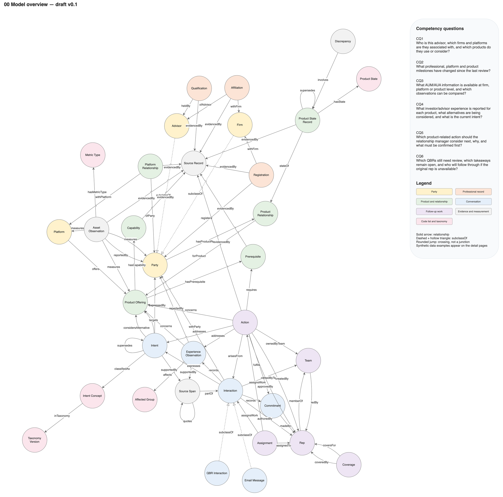
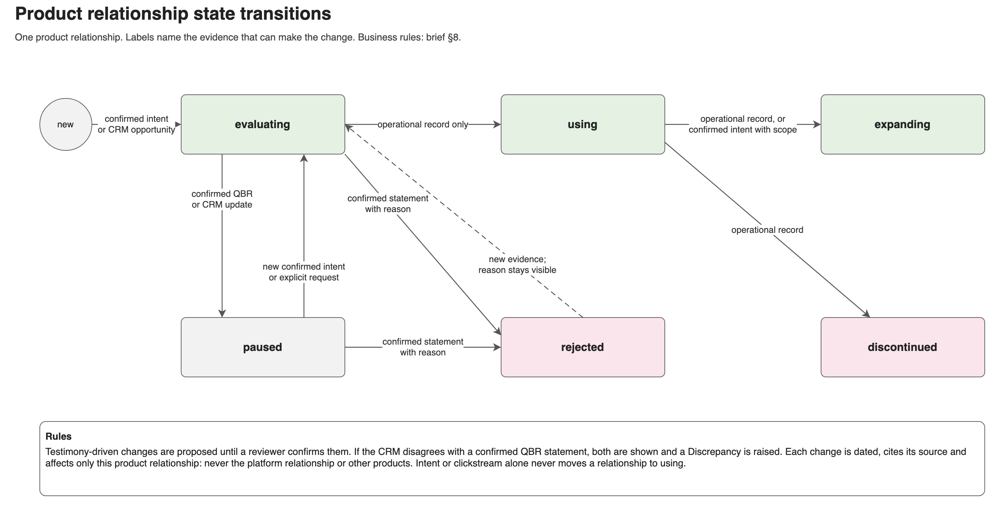

# Advisor Account Intelligence — Solution Design

Solution design · Version 0.1 · 19 October 2026 · Companion to [the product brief](../business/advisor-account-intelligence-product.md) and [memory architecture](memory-architecture.md)

This document holds the technical design moved out of product brief v0.5 (former sections 9–13), revised to match brief v0.6.

## 1. Architecture and technology choices


Source: [diagrams/solution-design.drawio](diagrams/solution-design.drawio), page "Solution architecture".

| Concern | Choice | Notes |
|---|---|---|
| Graph store | LadybugDB | Connected working view; does not replace each source's field-specific authority. Confirm its concurrency model before the multi-rep queue moves off the mock task store |
| Task store | Mock task interface | Shared queue, assignments, coverage, completion evidence |
| Source feeds | CSV and Markdown files | No live Snowflake/Salesforce connections initially |
| Procedure | Versioned Markdown plus structured step list | Permissions and approval checks live in application code |
| Agent runtime | One assistant in phase 1 | LangChain, LangGraph, LangSmith, and GraphRAG are candidates for later phases, not first-slice dependencies |
| Reporting | Timeline and simple intent/action report | Power BI, Sankey flows, and cohort analysis later |

Neo4j appears in prior experience only; it is not a requirement for this slice.

## 2. Knowledge model

The structural model is maintained in [model/](model/README.md): a Draw.io model with an overview and four detail pages, its OWL counterpart `aai-model.ttl`, and term governance in `aai-governance.ttl`. Modeling conventions are in [AGENTS.md](../AGENTS.md). Summary:



| Page | Concepts | Answers |
|---|---|---|
| 01 Advisors, firms and platforms | Party, Advisor, Firm, Platform, Affiliation, Qualification, Registration, Platform Relationship, Source Record | CQ1, CQ2 |
| 02 Products, state and assets | Product Offering, Capability, Prerequisite, Product Relationship, Product State Record, Product State, Discrepancy, Asset Observation, Metric Type | CQ1–CQ3 |
| 03 Interactions, experience and intent | Interaction (QBR Interaction, Email Message), Source Span, Experience Observation, Affected Group, Intent, Intent Concept, Taxonomy Version, Commitment | CQ2, CQ4 |
| 04 Follow-up and coverage | Action, Rep, Team, Assignment, Coverage | CQ5, CQ6 |

Key relationships:

| Relationship | Purpose |
|---|---|
| Platform → offers → Product Offering | Identify the specific offering and platform |
| Party → hasProductRelationship → Product Relationship → forProduct → Product Offering | One relationship per product, independent of the others |
| Product State Record → stateOf → Product Relationship; → supersedes → Product State Record | Dated, sourced state history |
| Interaction → records → Experience Observation → concerns → Product Offering | Connect reported experience to its product and source |
| Interaction → expresses → Intent → targets / considersAlternative → Product Offering | Bind intent to the right product and the alternatives actually discussed |
| Experience Observation / Intent → supportedBy → Source Span → partOf → Interaction | Provenance down to the exact statement |
| Source Span → quotes → Source Span | A repetition is linked to its original, not counted as new evidence |
| Asset Observation → measures → Party / Platform / Product Offering | Keep financial metrics at their evidenced scope |
| Action → addresses → Experience Observation / Intent; → requires → Prerequisite | Why the follow-up matters and what must be verified first |
| Assignment → assignsWork → Action / Interaction; → assignedTo → Rep | Ownership, effective once acknowledged |
| Coverage → coversFor / coveredBy → Rep | Continuity when a rep is unavailable |

Rep and Team are internal identities, disjoint from external parties. `createdBy` and `authoredBy` are independent of Assignment, so the author can leave without orphaning work. Temporal attributes, supersession, scopes and decay are specified in [memory-architecture.md](memory-architecture.md).

## 3. Product relationship state machine



Business rules are in brief §8. Implementation:

- State changes are written as dated Product State Records with `source_type` (operational record, QBR testimony, usage summary), `source_ref`, and `verification_state`.
- Testimony-driven transitions are stored as **proposed** until a relationship manager or analyst confirms them.
- When an operational record conflicts with confirmed testimony, both remain visible and a Discrepancy node links them; the brief shows the discrepancy rather than choosing silently.
- Each transition is scoped to one ProductRelationship; no transition cascades to other offerings or to the platform relationship.

## 4. Procedure

```
Identify advisor/firm and products → Retrieve QBR and catalog evidence → Reconcile experience and intent
  → Check alternatives, blockers, and metric scope → Propose product-specific action → Verify evidence → Manager approval
```

- Ambiguous product reference → clarify before assigning intent.
- Unresolved experience issue → consider service resolution alongside comparison or demonstration.
- Missing catalog evidence or prerequisite → request verification.
- Incompatible metrics → display separately.
- Source text is treated as data; instructions embedded in a QBR or email are never executed.

### QBR continuity workflow


The decisive phase 1 scenario (brief §15, WF3–WF4): the originating rep saves a note and becomes unavailable; the team lead activates coverage; the covering rep acknowledges, validates and completes the follow-up from preserved evidence.

## 5. Data feeds

| Feed | Business evidence | First-slice decision |
|---|---|---|
| Snowflake profile export → CSV | Advisor/firm identities, affiliations, and whichever qualifications, registrations, platform links, or asset observations the export supplies | Required synthetic fixture; confirm columns rather than assuming fields exist |
| Salesforce QBR export → Markdown | Stated product experience, intent, alternatives, blockers, commitments | Required; retain interaction ID, date, author/speaker, advisor/firm references, source spans |
| Salesforce email/activity export → Markdown | Follow-up correspondence, forwarded notes | Required minimal fixture (one forwarded email) to test repeated-quote handling |
| Product catalog and intent taxonomy → structured files/Markdown | Product identities/capabilities; approved intent meanings | Required reference fixtures |
| Historical clickstream → CSV | Observed use of platform technologies and features | Optional, phase 2 onward; small synthetic sample only when it tests a specific question |

Load sequence: preserve source files → validate identifiers and dates → reconcile identities → extract candidate observations → validate → populate/update graph with provenance. Keep source record IDs, event/as-of and ingestion times, and import versions so repeat imports are idempotent and corrections traceable.

### Clickstream handling

Clickstream distinguishes actor (investor, advisor, staff, unknown), technology/feature, event type, and timestamp. Portal interaction is not automatically use of an investment product; add an explicit feature-to-offering mapping where justified. Link a pseudonymous investor actor to an advisor/firm only through an authorized, reliable mapping; otherwise keep anonymous or aggregate observations with their scope.

Start with dated usage summaries linked to offerings rather than raw events in the graph. Activity can corroborate or contradict reported behavior, but clicks do not prove purchase intent, satisfaction, adoption, or assets held. Missing activity means unknown unless tracking coverage is established.

## 6. Intent taxonomy implementation

- Phase 1: a manually approved seed taxonomy file with stable concept IDs, definitions, inclusion/exclusion examples, and a version.
- Each extracted intent stores source span, concept ID, taxonomy version, and validation status. Multiple intents and an unmapped result are allowed.
- A reviewer correction queue and annotation records are enough to start.
- Later Taxonomy Assistant: retrieve approved concepts and examples, propose mappings or changes, show affected records, submit to the curator. Before publication, compare proposed changes on held-out QBR examples. Splits, merges, and retirements require explicit mappings and a migration decision; preserve original annotations.
- Optional experiment: compare prompted extraction with a small LoRA-tuned intent classifier on the same held-out set (accuracy, cost, latency).
- Measure curation time, unmapped rate, reviewer agreement, and downstream extraction quality.

## 7. Technical acceptance tests

In addition to the business golden cases in brief §13:

- Duplicate imports do not duplicate facts.
- Unknown taxonomy labels remain reviewable.
- Taxonomy revisions preserve reproducible historical annotations.
- Clickstream activity never becomes stated intent.
- An unmapped actor or technology is not attached to an advisor or product by guesswork.
- Embedded instructions in source text do not alter tool calls, retrieval scope, or output.
- Retrying a task write or handoff is idempotent.

Use held-out firms and later time periods to reduce leakage. Combine human-designed cases with reviewed agent-generated adversarial variants.

## 8. Serving and capacity (phase 5)

- Initial synthetic envelope: ten concurrent requests, up to 12,000 input tokens each, 1,500-token output cap.
- Provisional target: p95 completion within 30 seconds; validate, not a provider guarantee.
- Measure peak and normal traffic, context length, first-token latency, completion latency, timeouts, and cost per accepted brief.
- Test prefix caching (shared procedure and catalog prefix) and batching where supported.
- Azure AI and NVIDIA NVAIE/NIM serving are implementation experiments; self-hosting and disaggregated prefill/decode require measured reasons.
- Synthetic load tests demonstrate capacity, not real demand.

## 9. Diagram and model sources

| File | Pages | Regenerate |
|---|---|---|
| [diagrams/solution-design.drawio](diagrams/solution-design.drawio) | Solution architecture, Product state transitions, QBR continuity workflow | `.venv/bin/python solution/tools/build_diagrams.py` |
| [diagrams/memory-architecture.drawio](diagrams/memory-architecture.drawio) | Memory types and scopes, Write path and promotion, Context assembly, Agent handoff contract | same script |
| [model/aai-model.drawio](model/aai-model.drawio) and Turtle files | Model overview and four detail pages | `.venv/bin/python solution/tools/build_model.py`, then `check_model.py` |

Render PNGs with `.venv/bin/python solution/tools/render.py solution-design memory-architecture` and `render.py --model`. Rendering uses headless Chrome and fetches the diagrams.net viewer script from the network. The generators overwrite manual edits; once a diagram is edited by hand, update the generator or stop regenerating that file.
